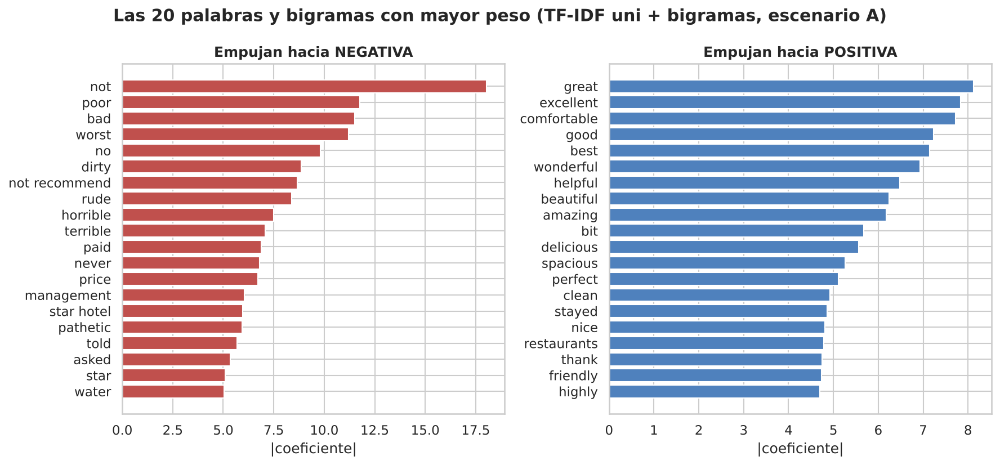
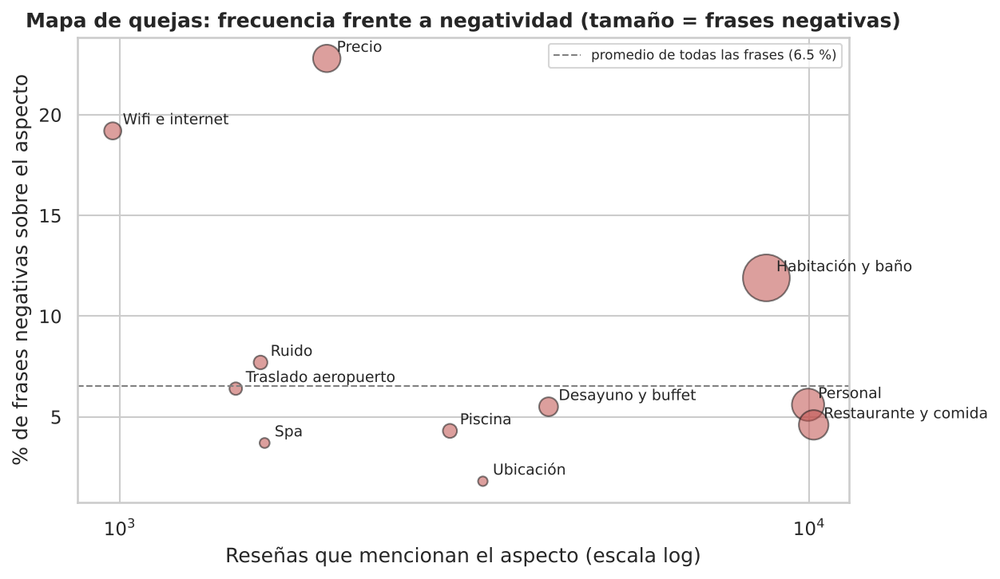

# Sentimiento y búsqueda por aspectos en reseñas de hoteles de lujo

Trabajo final de **Procesamiento de Lenguaje Natural**, Maestría en Analítica Aplicada e Inteligencia Artificial, Universidad de La Sabana. Profesor: Andrés Rosso, PhD.

**Autores:** Isabel Cristina Morales Parra · Jaime Esteban Bejarano Caldas

Sobre 17.976 reseñas de hoteles de lujo (2014–2024), el proyecto responde tres preguntas:

1. ¿Qué palabras caracterizan una opinión negativa frente a una positiva?
2. ¿Qué tan bien se predice la polaridad con representaciones dispersas (BoW, TF-IDF) y distribuidas (Word2Vec)?
3. ¿Cómo encontrar los comentarios sobre un aspecto ("piscina", "buffet"), en cualquier idioma, y saber qué se critica de él?

## Resultados principales

| Resultado | Cifra |
|:--|:--|
| Mejor clasificador: TF-IDF uni + bigramas | F1-macro 0,916 (IC95 [0,890; 0,939]), recall de negativas 0,862 |
| Validación temporal (entrena 2014–2021, prueba 2022–2024) | F1-macro 0,931: no hay deriva que dañe el modelo |
| Word2Vec frente a TF-IDF con 250 reseñas etiquetadas | 0,831 frente a 0,587; TF-IDF gana desde unas 2.000 |
| Palabras más asociadas a la queja | *star hotel* (9,9 veces más en negativas), *told* (13,6), *paid* (12,7) |
| Búsqueda en español con Sentence-BERT multilingüe | 7,4 de 10 resultados comunes con la consulta en inglés; BM25: 0 |
| Aspectos más criticados (frases negativas) | Precio 22,8 %, wifi 19,2 % (promedio 6,5 %) |





## Estructura

```
├── data/
│   ├── LuxuryHotels.csv            # conjunto de datos original
│   └── anotaciones/                # juicios de relevancia y validación de frases (los llena el equipo)
├── figures/                        # las 12 gráficas que genera el notebook
├── notebooks/
│   └── Proyecto_Final_PLN_LuxuryHotels.ipynb
├── references/referencias.md       # bibliografía
├── results/                        # tablas en CSV (modelos, palabras, curva, mapa de quejas, buscador)
├── src/
│   ├── preprocesamiento.py         # limpieza y tokenización
│   ├── metricas_ir.py              # P@k, AP@k, nDCG@k, RR@k
│   └── buscador.py                 # buscador por terminal
├── requirements.txt                # dependencias
└── requirements_lock.txt           # versiones exactas usadas
```

`cache/` y `modelos/` no se suben al repositorio: la caché se regenera al ejecutar el notebook (unos 15 minutos la primera vez) y el modelo pesa 235 MB.

## Cómo ejecutarlo

```bash
git clone https://github.com/estebansabana/NLP_Trabajo.git
cd NLP_Trabajo
python -m venv .venv && source .venv/bin/activate
pip install -r requirements.txt
jupyter notebook notebooks/Proyecto_Final_PLN_LuxuryHotels.ipynb
```

El notebook descarga el modelo Sentence-BERT de Hugging Face si no encuentra `modelos/paraphrase-multilingual-MiniLM-L12-v2/`.

Después de una primera ejecución, el buscador también funciona desde la terminal:

```bash
python -m src.buscador "piscina" -k 5
python -m src.buscador "slow wifi" --sistema bm25
```

## Contenido del notebook

| Sección | Contenido |
|:--|:--|
| 1–3 | Duplicados, detección de idioma, escenarios A (1–2★ frente a 4–5★) y C (5★ frente al resto), análisis exploratorio, limpieza con negaciones y enmascarado de nombres propios |
| 4–5 | Binaria, BoW y TF-IDF con regresión logística balanceada; palabras características con control de estabilidad |
| 6–7 | Word2Vec del dominio, curva de aprendizaje y proyecciones semánticas corregidas por el sentimiento general |
| 8 | Validación temporal y análisis de errores |
| 9 | Buscador: BM25, expansión con Word2Vec, Sentence-BERT multilingüe, fusión RRF, mapa de quejas por frase y evaluación con MAP |
| 10 | Conclusiones, limitaciones y trabajo futuro |

## Pendiente

La evaluación del buscador con MAP@10, P@10, nDCG@10 y MRR@10 requiere los juicios de relevancia de `data/anotaciones/juicios_relevancia.xlsx` (335 pares, con 30 dobles para el kappa). Cuando estén completos, basta con volver a ejecutar el notebook.
